<a href="https://github.com/baselissmail">
  <picture>
    <source media="(prefers-color-scheme: dark)" srcset="assets/header-dark.svg">
    
  </picture>
</a>

<p align="center"><samp>
  <a href="https://medium.com/@basel.issmail">medium</a> ·
  <a href="https://www.linkedin.com/in/basel-issmail">linkedin</a> ·
  <a href="https://x.com/Baselissmail">x</a> ·
  <a href="https://stackoverflow.com/users/8396204/basel-issmail">stack overflow</a> ·
  <a href="https://linktr.ee/basel.issmail">everything else</a> ·
  <a href="https://github.com/basel-kepler">work github ↗</a>
</samp></p>

I'm a tech lead at [Kepler](https://www.kepler.team), a product team for healthcare companies. I lead engineering on [EMRAY](https://emray.health), our platform for running digital-health tools inside the EHR, and on the telehealth, behavioral-health and AI products we build for clients. Ten years in, I care most about the parts that decide whether software actually works: sign-in flows, permissions, migrations, failure modes and the monthly bill. I like tools that tell you what's wrong in plain English, so I build them.

### Now

- **Launching [smart-doctor](https://github.com/baselissmail/smart-doctor)**, an open-source CLI that finds out why a SMART on FHIR login fails. v0.2 is out; next up is testing against the Epic and Oracle Health sandboxes.
- **Writing most days** on Medium about engineering judgment, reliability and working well next to AI.
- **Building [Glimby](https://glimby.app)** in the evenings: a gentle to-do app for adults with ADHD.

<sub>Updated October 2026.</sub>

## Pulse

Most of my commits land on my work account, **[@basel-kepler](https://github.com/basel-kepler)**, so the graph under this profile shows only part of the year. This monitor adds both accounts together and redraws itself every morning.

<a href="https://github.com/basel-kepler">
  
</a>

## At Kepler · 2023 – now

[Kepler](https://www.kepler.team) is a product team for healthcare companies: telehealth providers, behavioral-health and digital-therapeutics startups, medical-device makers and health-data businesses. I'm tech lead on [EMRAY](https://emray.health), Kepler's EHR-integrated platform, and on the client products built with it or beside it. That means architecture and a lot of the code, and it also means sitting with clients: production-readiness plans, HIPAA readiness reviews, onboarding a new EHR, and briefing hospital IT teams.

<table>
<tr>
<td width="50%" valign="top">

**EMRAY platform**<br><sub>2023 → now · 2,600+ of the platform's 5,900 commits</sub>

Clinicians open digital-health tools from inside their EHR with their EHR sign-in; patients get content and assessments on their own portal. Three Angular apps on serverless AWS, SOC 2 and HIPAA compliant.

- SMART on FHIR launch and backend services for **8 EHRs**: Epic, Oracle Health, athenahealth, AdvancedMD, Altera, Netsmart and more
- Designed **permissions generated from the GraphQL schema** for all 226 operations, rolled out behind a shadow-mode authorizer; [shipped in v3.0](https://emray.health/release-notes)
- Took the team's **Rust Lambda authorizers** to production: cold starts from 906 ms to 56 ms

<sub>Angular · AppSync · Lambda (TypeScript, Rust) · DynamoDB · Cognito · CDK · Terraform</sub>

</td>
<td width="50%" valign="top">

**AI Module Studio**<br><sub>2026 · shipped in v3.1 · designed and built it, 130+ commits and 15 design docs</sub>

An admin describes a clinical tool in chat. An agent writes it, a reviewer approves it, and it runs inside the provider portal next to the patient's chart.

- **Four layers of defence**: prompt rules, a build-time scan that bounces forbidden code back to the agent, an iframe sandbox without same-origin, and a CSP that blocks all network access
- **One way out**: a host-mediated API proxy with an allowlist, server-held credentials, SSRF guards and DNS pinning; EHR reads are consented per resource
- Bundles re-hashed before publish, reviewer dialogue, and customers bring their own Anthropic, Google or OpenAI key

<sub>LLM tool-use loop on Lambda · sandboxed iframes · postMessage RPC</sub>

</td>
</tr>
<tr>
<td width="50%" valign="top">

**Telehealth for care facilities**<br><sub>2023–25 · top contributor, 1,300+ commits · handed over to the client in 2025</sub>

A white-label EMRAY build for a telehealth provider. Facility nurses page a remote clinician from a live dashboard; the clinician acknowledges, joins a video visit, chats with the nurse during and after it, documents and records an outcome. Clinician schedules sync from Google Calendar, and it connects to PointClickCare and CharmHealth.

- **Led it from fork to its first releases** (v0.1 to v0.5, August to November 2024), then handed the code over to the client's own organization
- Wrote the **encounter workflows on Step Functions**: assignment, 10- and 15-minute reminder loops, documentation and a timed auto-close, driven by task-token callbacks
- Built the SMS and email fallbacks for unanswered pages, the nurse and encounter reports, and most of the Cognito triggers behind per-EHR sign-in

<sub>Angular 18 · Nx · NestJS on Lambda · Step Functions · Amazon Chime SDK · Terraform</sub>

</td>
<td width="50%" valign="top">

**Questionnaires on FHIR SDC**<br><sub>2026 · shipped in v4.0</sub>

Admins build assessments, clinicians assign them, patients answer as a chat or a page, and results come back as scores with severity bands. Replaces the chatbot-based intake.

- Brought a native **FHIR SDC engine** into the platform: `enableWhen` branching, ordinal scoring, validation, with PHQ-9 and GAD-7 in the library
- Built the **visual canvas builder** (after evaluating three graph libraries) and multi-tenant ownership with RBAC
- **AI governance**: models may prefill answers and summarize results, but never compute a score

<sub>FHIR R4 SDC · Angular · AppSync · LLM extract steps</sub>

</td>
</tr>
</table>

**Also at Kepler:** code for nine client products beyond EMRAY, six of them in depth; the `@emray/sdk` 2.0 that partners integrate with (top committer); a streaming EHR data-ingest pipeline; and a realtime voice-avatar prototype on the OpenAI Realtime API.

## Open source

<a href="https://github.com/baselissmail/smart-doctor">
  <picture>
    <source media="(prefers-color-scheme: dark)" srcset="https://raw.githubusercontent.com/baselissmail/smart-doctor/main/docs/images/banner-dark.png">
    
  </picture>
</a>

EHR token endpoints answer almost every client mistake with the same `invalid_client`. **[smart-doctor](https://github.com/baselissmail/smart-doctor)** checks everything that can be checked from your side, runs the real login once and ranks the likely causes in plain English, with evidence and the fix. Your keys and secrets never leave your machine.

```bash
npx smart-doctor ui --demo    # a practice EHR that fails on purpose, in your browser
```

- Backend services (`private_key_jwt`, client secrets) and user sign-in (SMART App Launch with PKCE), with hints for Epic, Oracle Health, athenahealth and OpenEMR
- Built to be trusted: [OpenSSF Best Practices](https://www.bestpractices.dev/projects/16012) badge, npm provenance, Sigstore-attested binaries, a Scorecard workflow and property-based tests
- Runs in CI as a [GitHub Action](https://github.com/baselissmail/smart-doctor#nightly-monitoring) that catches expiring keys every night, and ships as a Claude Code plugin

## The workshop

Things I build on my own time, end to end: product, design, code and launch.

| | What it is | Built with |
|---|---|---|
| **[Glimby](https://glimby.app)** | A gentle, gamified to-do app for adults with ADHD. Brain-dump everything, get one clear next step, no streaks or guilt. AI is cost-capped and optional, so it works offline. | Next.js 16, React 19, Postgres, Drizzle, Better Auth, Playwright + axe |
| **[LinePilot](https://www.linepilot.app)** | A [Chrome extension](https://chromewebstore.google.com/detail/linepilot/pfgifepnciihbddbkbjopjbhkcppcobc) that guides your eyes line by line so you read faster and drift less. Sentence-aware (Unicode UAX #29) and fully keyboard-accessible. | TypeScript, Manifest V3, Vite, Vitest |
| **Dental Lab OS** | Case tracking for dental labs, in Arabic and English. Multi-tenant, with tenant isolation in Postgres row-level security. *In progress.* | React 19, Hono, tRPC, Postgres 18, Drizzle |

## Before Kepler

- **Eukarya**, Japan · <sub>2021–23</sub><br>Front-end lead for [Re:Earth CMS](https://github.com/reearth/reearth-cms), the open-source CMS behind [PLATEAU VIEW 2.0](https://www.mlit.go.jp/plateau/): Japan's government-led 3D models of 100+ cities. Its most active committer while I was there, with 220+ commits.
- **dlimits**, Lebanon · <sub>2021–23</sub><br>Front ends for 15+ sites, including ICANN's. Took minbaladeh.world's performance grade from F to A on a store that went on to take $2M+ in orders.
- **Maids.cc**, UAE · <sub>2017–20</sub><br>Front-end lead for an Angular ERP used by a 5,000+ person company. Ran two teams, eight developers.
- **BISD, CLIC and Storex** · <sub>2016–18</sub><br>Built Shamra Jobs and Shamra Bazaar from scratch, set up a QA team, and cut 1.2 s off the load time of Shamra, an Arabic search engine.
- **Tishreen University** · <sub>2012–17</sub><br>BSc in Software Engineering, top 5%. My thesis generated the university's timetables with AI and was graded 98%, the year's best. ACM SCPC 2015 Extreme Programmers award.

## Latest writing

<!-- posts:start -->
- [The AI Future Where You Can’t Say No](https://medium.com/@basel.issmail/the-ai-future-where-you-cant-say-no-774142379e40) <sub>· Oct 27, 2026</sub>
- [“Just Add Login” Is Doing a Lot of Work in That Prompt](https://medium.com/@basel.issmail/just-add-login-is-doing-a-lot-of-work-in-that-prompt-eeb14c8a1ab4) <sub>· Oct 26, 2026</sub>
- [AI Took the Keyboard. You Kept the Blame.](https://medium.com/@basel.issmail/ai-took-the-keyboard-you-kept-the-blame-b269e872c3d9) <sub>· Oct 25, 2026</sub>
- [Google Authenticator Is a Tiny Distributed System](https://medium.com/codex/google-authenticator-is-a-tiny-distributed-system-46f2c4351706) <sub>· Oct 23, 2026</sub>
- [You Can’t Reinvent Yourself Every Tuesday](https://medium.com/@basel.issmail/you-cant-reinvent-yourself-every-tuesday-9afaff70acd0) <sub>· Oct 22, 2026</sub>
<!-- posts:end -->

<sub>Refreshed daily from my <a href="https://medium.com/@basel.issmail">Medium feed</a> by a <a href=".github/workflows/writing.yml">GitHub Action</a>.</sub>

## Toolbox

- **Every day:** TypeScript · Angular · React · Node.js · AWS (CDK, AppSync, Lambda, DynamoDB, Cognito, Step Functions, Chime SDK) · Terraform · GitHub Actions
- **Healthcare:** FHIR R4 · SMART on FHIR · FHIR SDC · EHR onboarding · HIPAA and SOC 2 controls
- **AI:** tool-use agents · sandboxed code generation · Anthropic, OpenAI and Google APIs · OpenAI Realtime
- **Also:** Rust · Next.js · Postgres · Playwright · Python

Arabic is my first language, I work in English, and I get by in Russian.

<p align="center"><sub><em>“Design systems as if every millisecond and every cent comes from your own wallet.”</em></sub></p>
